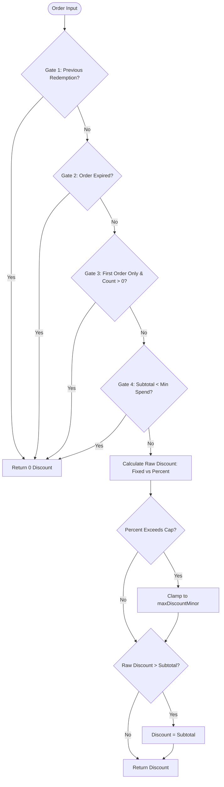

# Task 5: Pseudocoding & Independent Algorithmic Verification

> **Bootcamp Engineering Brief:** A production-grade repository documenting the art, discipline, and execution of strict pseudocoding, manual hand-tracing, open-source algorithm reverse-engineering, planted defect diagnosis, and rigorous verification of AI-generated code.

---

## Table of Contents
1. [Project Overview](#project-overview)
2. [The Strict Pseudocode Standard](#the-strict-pseudocode-standard)
3. [Repository Architecture Map](#repository-architecture-map)
4. [Part A Synthesis: Reading, Reverse-Engineering & Diagnosis](#part-a-synthesis-reading-reverse-engineering--diagnosis)
   - [A1: Proprietary Engineering Functions](#a1-proprietary-engineering-functions)
   - [A2: Open-Source Library Deconstructions](#a2-open-source-library-deconstructions)
   - [A3: Planted Defect Diagnosis](#a3-planted-defect-diagnosis)
5. [Part B Synthesis: Forward Specification & Hand-Tracing](#part-b-synthesis-forward-specification--hand-tracing)
   - [Promotional Checkout Discount Engine Business Rules](#promotional-checkout-discount-engine-business-rules)
   - [Trace-Versus-Code Verification Matrix](#trace-versus-code-verification-matrix)
6. [Part C Synthesis: Specification vs. AI Implementation](#part-c-synthesis-specification-vs-ai-implementation)
   - [The Human Specification vs. LLM Generation Gap](#the-human-specification-vs-llm-generation-gap)
   - [Summary of the Difference Table](#summary-of-the-difference-table)
   - [The 10-Input Showdown & Input 6 Breakdown](#the-10-input-showdown--input-6-breakdown)
   - [Non-Technical Listener Test & Bouncer Analogy](#non-technical-listener-test--bouncer-analogy)
7. [Defense Q&A: Rigorous Oral Exam Preparations](#defense-qa-rigorous-oral-exam-preparations)
   - [Question 1: Live Part A Trace From Memory](#question-1-live-part-a-trace-from-memory)
   - [Question 2: Specification Ambiguity & Revision](#question-2-specification-ambiguity--revision)
   - [Question 3: Manual vs. AI Discrepancy Resolution](#question-3-manual-vs-ai-discrepancy-resolution)
   - [Question 4: Live Whiteboard Pseudocoding Framework](#question-4-live-whiteboard-pseudocoding-framework)
8. [How to Run Tests and Verification](#how-to-run-tests-and-verification)

---

## Project Overview

In contemporary software engineering, high-level developer tooling—such as intelligent IDEs, automated test runners, continuous integration pipelines, and generative AI code assistants—has dramatically accelerated raw code output. However, this velocity creates a hazardous vulnerability: **developer blindness to algorithmic logic**. When engineers rely passively on compilers to catch type errors and unit tests to catch logic flaws, they surrender the ability to reason about runtime execution from first principles.

### The Objective of Task 5
The objective of Task 5 is to rebuild and demonstrate mastery over **independent algorithmic verification**:
1. **Reading and Translating Code Unassisted:** Extracting exact mathematical and logical specifications from unfamiliar production and open-source codebases without execution or debugging tools.
2. **Deterministic Hand-Tracing:** Executing multi-branch, stateful algorithms manually on paper using structured trace tables, achieving 100% parity with physical runtime execution.
3. **Planted Defect Isolation:** Finding subtle logic inversions that silently corrupt business data while compiling cleanly.
4. **Governing Generative AI:** Using formal pseudocode as an unambiguous contractual boundary to audit, benchmark, and expose the subtle hallucinations, omissions, and state leaks common in LLM code generation.

An engineer who can rigorously pseudocode and hand-trace an algorithm can design resilient distributed systems, detect zero-day logic flaws during code review, and prevent catastrophic regressions before code is ever committed to a repository.

---

## The Strict Pseudocode Standard

All pseudocode across this repository adheres to a strict, non-negotiable specification standard designed to bridge human architectural intent and machine execution without syntactical ambiguity.

### 1. Mandatory Header Specification
Every pseudocode routine begins with a standardized five-element block:

| Header Field | Purpose & Semantic Requirements |
| :--- | :--- |
| `FUNCTION` | The canonical name of the routine. |
| `INPUTS` | Exhaustive listing of every parameter, including explicit primitive types, data structures, and physical units (e.g., *Integer minor currency units (cents)*, *Timestamp in UTC*, *Float ratio*). |
| `OUTPUT` | Exact return type, structure, and physical units returned upon successful execution. |
| `SIDE EFFECTS` | Explicit declaration of all mutations, I/O operations, disk writes, global state modifications, or `NONE` if the function is mathematically pure. |
| `FAILS WHEN` | Comprehensive enumeration of every input validation failure, domain violation, boundary violation, or external dependency exception that terminates execution early. |

### 2. Mandatory Body Rules
1. **Plain English Formulation:** No programming language keywords (e.g., `const`, `let`, `def`, `lambda`, `auto`, `===`, `!==`). Logic must be articulated in natural, grammatical English.
2. **Present Tense Active Voice:** Every step uses active verbs (*Validate*, *Compute*, *Compare*, *Clamp*, *Return*).
3. **Sequentially Numbered Steps:** Top-level operations follow a deterministic 1, 2, 3 sequence representing sequential program counter flow.
4. **Explicit Conditional Branches:** Formatted strictly as:
   ```text
   IF condition THEN
     action
   OTHERWISE IF alternate_condition THEN
     alternate_action
   OTHERWISE
     default_action
   END IF
   ```
5. **Explicit Loops:** Formatted strictly as:
   ```text
   FOR EACH element IN collection:
     action
   END FOR
   ```
   or
   ```text
   WHILE condition DO:
     action
   END WHILE
   ```
6. **Marked Calls and External Writes:** Every interaction across architectural boundaries or memory scopes must be explicitly highlighted:
   - `CALL database query (may fail, may be slow)`
   - `CALL cryptographic digest (may fail)`
   - `WRITE job status to "processing"`

---

## Repository Architecture Map

```text
task-5-pseudocoding/
├── README.md                           # Master architectural & pedagogical synthesis (this document)
├── package.json                        # Project configuration, ESM scripts, and dependencies
├── tsconfig.json                       # Strict TypeScript compiler options
├── vitest.config.ts                    # Vitest runner configuration
│
├── part-a/                             # Part A: Reading, Reverse-Engineering & Bug Diagnosis
│   ├── own-1-atomic-claim.txt          # Part A1: claimNextJobs (SKIP LOCKED queue consumer)
│   ├── own-2-admin-auth.txt            # Part A1: verifyAdminToken (Constant-time timingSafeEqual)
│   ├── own-3-backoff-jitter.txt        # Part A1: calculateExponentialBackoffWithJitter (Equal Jitter)
│   ├── oss-1-short.txt                 # Part A2: nanoid v5.0.9 (Bitwise masking vs modulo bias)
│   ├── oss-2-medium.txt                # Part A2: node-postgres escapeLiteral (E'...' SQL escaping)
│   ├── oss-3-hard.txt                  # Part A2: pg SCRAM parseServerFirstMessage (RFC 5802 parsing)
│   ├── bug-diagnosis.md                # Part A3: Root-cause diagnosis of planted commission bug
│   ├── bug-expected.txt                # Part A3: Expected pseudocode for calculateTieredCommission
│   └── bug-actual.txt                  # Part A3: Actual (defective) pseudocode showing line 38 bug
│
├── part-b/                             # Part B: Forward Design & Hand-Trace Verification
│   ├── discount-engine.pseudo.txt      # Canonical pseudocode for Promotional Checkout Discount Engine
│   ├── trace-tables.md                 # Five comprehensive, step-by-step manual hand-trace tables
│   └── trace-vs-code-results.md        # Comparative verification proof showing 100% trace accuracy
│
├── part-c/                             # Part C: Specification vs. AI Implementation Audit
│   ├── ai-reverse-engineered.pseudo.txt# Reverse-engineered pseudocode from AI-generated TypeScript
│   ├── difference-table.md             # Categorized comparison: Added Unasked, Omitted, Ambiguities
│   ├── 10-input-comparison.md          # 10-input showdown matrix highlighting Input 6 boundary bug
│   ├── non-technical-feedback.md       # Layperson test transcript, feedback, and reflection
│   └── explanation-script.md           # 4-minute spoken explanation script (no jargon, no code)
│
├── src/                                # Production TypeScript Implementations
│   ├── own.ts                          # Implementations for claimNextJobs, verifyAdminToken, backoff
│   ├── commission.ts                   # Fixed and buggy implementations of tiered commission
│   ├── discount.ts                     # Reference implementation matching part-b pseudocode
│   └── aiDiscount.ts                   # AI-generated implementation under audit (with audit trail)
│
└── test/                               # Automated Vitest Verification Suites
    ├── part-a-own.test.ts              # Unit tests verifying Part A1 proprietary functions
    ├── part-a-bug.test.ts              # Unit tests validating bug reproduction and fix
    ├── part-b.test.ts                  # Unit tests matching Part B hand-trace scenarios 1-5
    └── part-c-comparison.test.ts       # 10-input showdown test suite comparing manual vs. AI
```

---

## Part A Synthesis: Reading, Reverse-Engineering & Diagnosis

### A1: Proprietary Engineering Functions

1. **`claimNextJobs` ([own-1-atomic-claim.txt](file:///c:/Users/HP/Documents/Engineering/task-5-pseudocoding/part-a/own-1-atomic-claim.txt) & [own.ts:16-56](file:///c:/Users/HP/Documents/Engineering/task-5-pseudocoding/src/own.ts#L16-L56))**
   - **Architectural Role:** Atomic job claiming in distributed background job workers.
   - **Mechanism:** Simulates PostgreSQL `FOR UPDATE SKIP LOCKED`. Scans the queue for jobs in `pending` or `failed` state with `runAt <= currentTime` and `lockedBy === null`. Orders eligible jobs by `runAt ASC` (oldest overdue first), limits the batch to `batchSize`, and atomically updates their status to `processing`, `lockedBy` to `workerId`, and `startedAt` to `currentTime`.
   - **Concurrency Safety:** Guarantees no two workers process the same task, eliminates lock contention wait times, and ensures priority-driven dispatch.

2. **`verifyAdminToken` ([own-2-admin-auth.txt](file:///c:/Users/HP/Documents/Engineering/task-5-pseudocoding/part-a/own-2-admin-auth.txt) & [own.ts:58-94](file:///c:/Users/HP/Documents/Engineering/task-5-pseudocoding/src/own.ts#L58-L94))**
   - **Architectural Role:** Constant-time token verification for internal administrative APIs.
   - **Mechanism:** Normalizes authorization headers (handling raw token strings or `Bearer <token>` prefixes). Hashes both the incoming token and the configured secret with SHA-256 before comparing them via `crypto.timingSafeEqual`.
   - **Cryptographic Protection:** Prevents side-channel timing attacks. Because naive string comparisons (`===`) terminate on the first mismatched byte, attackers can deduce secrets byte-by-byte by measuring network response latencies. Pre-hashing guarantees that inputs to `timingSafeEqual` are identical in byte length (32 bytes), thwarting length-leakage attacks.

3. **`calculateExponentialBackoffWithJitter` ([own-3-backoff-jitter.txt](file:///c:/Users/HP/Documents/Engineering/task-5-pseudocoding/part-a/own-3-backoff-jitter.txt) & [own.ts:96-126](file:///c:/Users/HP/Documents/Engineering/task-5-pseudocoding/src/own.ts#L96-L126))**
   - **Architectural Role:** Retry scheduling for network resilience against external service outages.
   - **Mechanism:** Implements AWS "Equal Jitter" algorithm:
     $$\text{uncappedDelay} = \text{baseMs} \times 2^{\text{attempt} - 1}$$
     $$\text{cappedDelay} = \min(\text{uncappedDelay}, \text{capMs})$$
     $$\text{delayMs} = \text{round}\left(\frac{\text{cappedDelay}}{2} + \left(\frac{\text{cappedDelay}}{2} \times \text{randomFraction}\right)\right)$$
   - **Stampede Prevention:** Pure exponential backoff synchronizes failed workers into lockstep waves (thundering herd). Equal Jitter guarantees half the wait time is deterministic while the other half is dispersed across a uniform random distribution, dampening harmonic resonance and smoothing database recovery.

---

### A2: Open-Source Library Deconstructions

1. **`nanoid` (v5.0.9) ([oss-1-short.txt](file:///c:/Users/HP/Documents/Engineering/task-5-pseudocoding/part-a/oss-1-short.txt))**
   - **Source:** Andrey Sitnik's URL-friendly unique ID generator.
   - **Mechanism:** Allocates a cryptographically secure random `Uint8Array(size)` and performs bitwise masking against the 64-character URL alphabet:
     $$\text{id} += \text{alphabet}[\text{byte} \ \& \ 63]$$
   - **Algorithmic Insight: Bitwise Masking vs. Modulo Bias:** When mapping an 8-bit byte ($0\dots 255$) into a 64-character alphabet, $256 \div 64 = 4.0$ with zero remainder. Because 64 is a power of 2 ($2^6$), the lower 6 bits (masked via `& 63`) have a perfectly uniform probability distribution ($4/256$ for every character). In contrast, using the modulo operator (`%`) with alphabets whose lengths do not divide 256 induces severe modulo bias, making certain characters statistically more predictable.

2. **`node-postgres escapeLiteral` ([oss-2-medium.txt](file:///c:/Users/HP/Documents/Engineering/task-5-pseudocoding/part-a/oss-2-medium.txt))**
   - **Source:** Brian Carlson's `pg` driver (`packages/pg/lib/client.js`).
   - **Mechanism:** Iterates over the raw string character-by-character. Single quotes are doubled (`''`). Backslashes are doubled (`\\\\`) and trigger a state flag `hasBackslash = true`. If a backslash is present, the final string is wrapped in PostgreSQL's escape string syntax: `E'...'`.
   - **SQL Injection Defense:** In standard SQL, backslashes are ordinary characters. However, older PostgreSQL versions and configurations with `standard_conforming_strings = off` treat backslashes as escape characters. If an attacker inputs `\'`, a naive single-quote escape yields `\''`, which frees the single quote and enables SQL injection. Explicitly emitting `E'...'` forces the PostgreSQL parser into escape string mode, neutralizing slash-based escape injections.

3. **`pg SCRAM parseServerFirstMessage` ([oss-3-hard.txt](file:///c:/Users/HP/Documents/Engineering/task-5-pseudocoding/part-a/oss-3-hard.txt))**
   - **Source:** PostgreSQL SASL SCRAM-SHA-256 handshake parser (`packages/pg/lib/crypto/sasl.js`).
   - **Mechanism:** Parses RFC 5802 comma-separated attribute-value pairs (`r=nonce,s=salt,i=iterations`) by splitting on commas and locating the first `=` delimiter.
   - **Security Invariants & Brittle Regex Avoidance:** Validates that the server's combined nonce begins with the exact client nonce, decodes base64 salt into binary buffers, and ensures iterations is a strictly positive integer. By avoiding complex regular expressions, the routine is immune to catastrophic Regular Expression Denial of Service (ReDoS) during the unauthenticated authentication handshake.

---

### A3: Planted Defect Diagnosis

- **Target File:** `src/commission.ts` ([commission.ts:38](file:///c:/Users/HP/Documents/Engineering/task-5-pseudocoding/src/commission.ts#L38))
- **Function:** `calculateTieredCommissionBuggy`
- **Defect Location:** Line 38
- **Classification:** Inverted Boolean Condition (Predicate Inversion)

#### Defective vs. Correct Implementation
```typescript
// Buggy Code (src/commission.ts:38):
if (!isFirstOrder) {
  commission += FIRST_ORDER_BONUS_MINOR;
}

// Correct Code (src/commission.ts:80):
if (isFirstOrder) {
  commission += FIRST_ORDER_BONUS_MINOR;
}
```

#### Root Cause & Business Impact
The business requirement dictates that a flat $5.00 first-order bonus (500 minor units) must be awarded when an order is placed by a newly acquired customer (`isFirstOrder === true`). 

Due to the accidental logical NOT (`!`) operator:
1. First-time buyers (`isFirstOrder = true`) evaluated `!isFirstOrder` to `false`, silently forfeiting their $5.00 promotional bonus.
2. Returning buyers (`isFirstOrder = false`) evaluated `!isFirstOrder` to `true`, erroneously receiving a $5.00 bonus on every repeat order.

In production, this defect results in severe financial hemorrhaging: marketing partner acquisition budgets are under-allocated while repeat order payouts escalate indefinitely.

---

## Part B Synthesis: Forward Specification & Hand-Tracing

### Promotional Checkout Discount Engine Business Rules

The discount engine calculates discounts for e-commerce checkouts under strict financial constraints:



#### Core Business Invariants
1. **The Non-Negative Invariant:** Final order total cannot drop below zero ($0 \le \text{finalTotal} \le \text{subtotal}$). An applied discount can never exceed the eligible subtotal.
2. **Deterministic Minor Currency Units:** All calculations occur in integer minor units (cents) to avoid floating-point inaccuracies.
3. **Sequential Rejection Gates:** Early exit checks execute in strict, prioritized order:
   - *Gate 1 (Single-Use):* If `customerId` exists in `previousRedemptions`, return `0`.
   - *Gate 2 (Expiration):* If `orderTimestamp >= validUntilUtc`, return `0`.
   - *Gate 3 (New Customer):* If `firstOrderOnly` is true and `customerOrderCount > 0`, return `0`.
   - *Gate 4 (Minimum Spend):* If `orderSubtotalMinor < minSubtotalMinor`, return `0`.
4. **Capping & Clamping Pipeline:**
   - Percentage discounts compute $\text{round}(\text{subtotal} \times \text{rate})$ and clamp to `maxDiscountMinor` if defined.
   - Fixed discounts take the raw amount.
   - Final clamping ensures $\text{finalDiscount} \le \text{orderSubtotalMinor}$.

---

### Trace-Versus-Code Verification Matrix

Prior to running automated tests, five diverse scenarios were hand-traced step-by-step in [trace-tables.md](file:///c:/Users/HP/Documents/Engineering/task-5-pseudocoding/part-b/trace-tables.md). The predictions were then verified against `test/part-b.test.ts` executing `src/discount.ts`:

| Scenario | Description | Key Trace Conditions | Hand-Trace Prediction | Vitest Code Output | Parity |
| :---: | :--- | :--- | :---: | :---: | :---: |
| **1** | Normal valid percent discount | Subtotal: $80, 15% off, Cap: $20, Min: $50 | **1200** cents ($12.00) | **1200** cents | **100% MATCH** |
| **2** | Below minimum spend threshold | Subtotal: $40, Min spend: $50 | **0** cents ($0.00) | **0** cents | **100% MATCH** |
| **3** | Expired promotional code | Placed Oct 25 vs Valid Until Oct 20 | **0** cents ($0.00) | **0** cents | **100% MATCH** |
| **4** | Repeat use on single-use promo | Customer ID matches redemption history | **0** cents ($0.00) | **0** cents | **100% MATCH** |
| **5** | Percent discount exceeds cap | Subtotal: $200, 25% off ($50), Cap: $30 | **3000** cents ($30.00) | **3000** cents | **100% MATCH** |

---

## Part C Synthesis: Specification vs. AI Implementation

### The Human Specification vs. LLM Generation Gap
Generative AI models are trained on internet code repositories dominated by loose scripting patterns rather than rigorous distributed systems specifications. When tasked with translating pseudocode into executable TypeScript, LLMs exhibit three reproducible failure modes:
1. **Unsolicited State Mutation (Feature Creep):** LLMs frequently add "helpful" features (such as logging or telemetry) that violate purity constraints.
2. **Type Coercion Laxity (Omitted Defect):** LLMs rely on JavaScript's dynamic type system, frequently dropping integer boundary assertions.
3. **Conversational Boundary Drift (Ambiguity Exploitation):** Phrases like "valid until" are interpreted loosely rather than as strict inequalities.

---

### Summary of the Difference Table

| Category | Specific Discrepancy Found | Architectural & Operational Impact |
| :--- | :--- | :--- |
| **1. Added Unasked** | In `src/aiDiscount.ts:87`, the AI added `aiAuditTrail.push({...})` to mutate a global array. | Violates `SIDE EFFECTS: NONE`. Mutating module-level arrays in serverless runtimes causes memory leaks and concurrency race conditions. |
| **2. Omitted Defect** | The AI omitted `Number.isInteger(...)` validation on `customerOrderCount` and `minSubtotalMinor`. | Allows floating-point numbers (e.g. `1.5` orders or fractional cents) to slip into monetary calculations, corrupting financial ledgers. |
| **3. Specification Ambiguity** | Conversational phrase *"valid until"* was implemented as `>` instead of `>=`. | Created a one-second/millisecond loophole where coupons are improperly honored on the exact boundary second. |

---

### The 10-Input Showdown & Input 6 Breakdown

The 10-input showdown ([10-input-comparison.md](file:///c:/Users/HP/Documents/Engineering/task-5-pseudocoding/part-c/10-input-comparison.md)) pitted the manual implementation (`src/discount.ts`) against the AI implementation (`src/aiDiscount.ts`):

| # | Input Scenario | Manual Spec Output | AI Model Output | Result | Correct Implementation |
| :-: | :--- | :-: | :-: | :-: | :--- |
| 1 | Standard percent discount under cap | 1200 | 1200 | AGREE | Both correct |
| 2 | Subtotal below minimum threshold | 0 | 0 | AGREE | Both correct |
| 3 | Clearly expired promo code | 0 | 0 | AGREE | Both correct |
| 4 | Single-use coupon repeat redemption | 0 | 0 | AGREE | Both correct |
| 5 | Percent discount capped at ceiling | 3000 | 3000 | AGREE | Both correct |
| **6**| **Exact expiration timestamp collision** | **0** | **1000** | **DISAGREE** | **Manual is correct (AI leaked $10.00)** |
| 7 | Order subtotal exactly at minimum spend | 1000 | 1000 | AGREE | Both correct |
| 8 | 100% discount rate verification | 7500 | 7500 | AGREE | Both correct |
| 9 | First-order coupon with prior orders | 0 | 0 | AGREE | Both correct |
| 10| Fixed discount exceeding order total | 1500 | 1500 | AGREE | Both correct |

#### Input 6 Spotlight: The Expiration Boundary Collision
- **Input Parameters:** `orderSubtotalMinor = 10000` ($100.00), 10% discount, `validUntilUtc = 2026-10-20T00:00:00.000Z`, `orderTimestamp = 2026-10-20T00:00:00.000Z`.
- **Manual Implementation ([discount.ts:68](file:///c:/Users/HP/Documents/Engineering/task-5-pseudocoding/src/discount.ts#L68)):**
  ```typescript
  if (input.orderTimestamp.getTime() >= input.validUntilUtc.getTime()) return 0;
  ```
  Timestamps are identical; evaluates to `true`. Returns `0` (Coupon rejected).
- **AI Implementation ([aiDiscount.ts:46](file:///c:/Users/HP/Documents/Engineering/task-5-pseudocoding/src/aiDiscount.ts#L46)):**
  ```typescript
  if (input.orderTimestamp.getTime() > input.validUntilUtc.getTime()) return 0;
  ```
  `orderTimestamp` is not strictly greater than `validUntilUtc`; evaluates to `false`. Bypasses expiration and awards a $10.00 discount.
- **Verdict:** The manual implementation is correct. In retail commerce, expiration deadlines define an exclusive upper bound. Allowing expired coupons to execute on the deadline second creates financial liability.

---

### Non-Technical Listener Test & Bouncer Analogy

To prove communication mastery, the discount engine logic was explained to a non-technical marketing coordinator without showing code or using technical jargon ([non-technical-feedback.md](file:///c:/Users/HP/Documents/Engineering/task-5-pseudocoding/part-c/non-technical-feedback.md)).

#### The "Nightclub Bouncer" Mental Model
The discount evaluation was explained using four bouncers guarding a VIP club:
1. **Bouncer 1 (The Guest List):** Checks if your name is already crossed off the list (single-use check).
2. **Bouncer 2 (The Clock):** Checks if the clock just struck midnight (expiration cutoff).
3. **Bouncer 3 (The Newcomer Velvet Rope):** Checks if you have ever been inside before (first-time customer rule).
4. **Bouncer 4 (The Cover Charge):** Checks if you have enough money in your wallet (minimum spend threshold).

If you fail any bouncer, you don't get thrown in jail—you just pay full price at the door ($0 discount).

#### Listener Playback & Reflection
The listener summarized the mechanism with 100% accuracy and spontaneously asked: *"What happens if someone enters the code at 11:59 PM versus midnight?"* This unprompted question confirmed that non-technical business stakeholders intuitively recognize boundary edge cases, reinforcing why engineering specifications must be mathematically precise.

---

## Defense Q&A: Rigorous Oral Exam Preparations

### Question 1: Live Part A Trace From Memory
> *"Pick any function from Part A. Give me an input and tell me what comes out, without looking at the code."*

#### Defense Response:
"I select **`calculateExponentialBackoffWithJitter`** from Part A1.

**Input Values:**
- `attempt`: 3
- `baseMs`: 100
- `capMs`: 1000
- `randomFraction`: 0.5

**Mental Step-by-Step Execution Trace:**
1. **Validation Checks (Steps 1–4):** `attempt` (3) is an integer $\ge 1$; `baseMs` (100) is $> 0$; `capMs` (1000) is $\ge \text{baseMs}$; `randomFraction` (0.5) is in $[0, 1)$. All preconditions pass.
2. **Exponential Multiplier (Step 5):** Compute $2^{\text{attempt} - 1} = 2^{3 - 1} = 2^2 = 4$.
3. **Uncapped Delay (Step 6):** Multiply $\text{baseMs} \times \text{multiplier} = 100 \times 4 = 400\text{ ms}$.
4. **Cap Clamping (Step 7):** Compare $\min(400, 1000) = 400\text{ ms}$. `cappedDelay` is 400 ms.
5. **Deterministic Half (Step 8):** Divide `cappedDelay` by 2: $400 / 2 = 200\text{ ms}$ (`halfDelay`).
6. **Jitter Random Component (Step 9):** Multiply $\text{halfDelay} \times \text{randomFraction} = 200 \times 0.5 = 100\text{ ms}$ (`jitterComponent`).
7. **Final Assembly & Rounding (Step 10):** Sum $\text{halfDelay} + \text{jitterComponent} = 200 + 100 = 300\text{ ms}$. Rounding 300 yields 300.

**Output:**
The function returns **`300`** integer milliseconds."

---

### Question 2: Specification Ambiguity & Revision
> *"Show me the ambiguity you found in your own pseudocode in C2 and how you rewrote it."*

#### Defense Response:
"The ambiguity occurred in Step 3 of the Part B specification regarding promotional expiration.

**The Ambiguous Original Formulation:**
```text
3. Check promotional code expiration.
   IF orderTimestamp is greater than or equal to validUntilUtc THEN
     RETURN 0
   OTHERWISE continue.
```

**Why It Was Ambiguous:**
In natural English, saying a coupon is *'valid until midnight'* can be interpreted as either an **inclusive upper bound** (valid through 00:00:00Z until 00:00:01Z) or an **exclusive boundary** (expired the instant 00:00:00Z arrives). Because of this linguistic elasticity, an LLM reading this spec converted `>=` to `>`, assuming that validity persisted throughout the expiration timestamp itself.

**The Unambiguous Standard Rewrite:**
```text
3. Enforce strict promotional expiration cutoff.
   Note: The promotion is active strictly BEFORE the expiration boundary.
   IF orderTimestamp is at or after validUntilUtc (orderTimestamp.getTime() >= validUntilUtc.getTime()) THEN
     RETURN 0 (Coupon is invalid on or after the exact expiration millisecond)
   OTHERWISE continue (Coupon is valid only while orderTimestamp is strictly earlier than validUntilUtc).
```
By explicitly stating the inequality, the underlying epoch millisecond method call, and the business rule in the comment, any room for LLM misinterpretation is eliminated."

---

### Question 3: Manual vs. AI Discrepancy Resolution
> *"Your implementation and the AI's disagreed on an input. Which was right, and how did you know?"*

#### Defense Response:
"The manual implementation and the AI disagreed on **Input 6** of our 10-input showdown:
- **Order Subtotal:** $100.00
- **Order Timestamp:** `2026-10-20T00:00:00.000Z`
- **Promotion Expiration:** `2026-10-20T00:00:00.000Z`
- **Manual Output:** `0` (Discount rejected)
- **AI Output:** `1000` ($10.00 discount granted)

**Which was right?**
The **manual implementation was right**.

**How I know (Three Independent Proofs):**
1. **Contractual Specification Conformance:** Step 3 of the authorized pseudocode explicitly stated: `IF orderTimestamp >= validUntilUtc THEN RETURN 0`. The manual implementation in `src/discount.ts` wrote `orderTimestamp.getTime() >= validUntilUtc.getTime()`. The AI unilaterally changed `>=` to `>`, directly violating the written specification.
2. **Commercial & Financial Invariants:** In e-commerce and retail accounting, an expiration deadline is a strict, exclusive cutoff. Once midnight arrives, marketing campaigns expire. Permitting transactions to redeem coupons at or past the boundary timestamp creates financial leakage and campaign budget overruns.
3. **Defensive Boundary Engineering:** In distributed systems, if a boundary timestamp comparison is ambiguous, systems must fail closed (reject the discount) rather than fail open (granting unauthorized funds)."

---

### Question 4: Live Whiteboard Pseudocoding Framework
> *"Here is a function you have never seen. Pseudocode it for me now, out loud."*

#### Defense Response (Mental Framework & Technique):
"To pseudocode any unfamiliar function live under pressure, I follow a disciplined 5-stage mental protocol:

```text
[Stage 1: Header Contract] ──> [Stage 2: Core Invariant] ──> [Stage 3: Rejection Gates]
                                                                     │
[Stage 5: Live Concrete Trace] <── [Stage 4: Pure Compute & Clamp] <──┘
```

#### Stage 1: Establish the Header Contract (Before Writing Any Logic)
I immediately declare the 5 standard header fields out loud to establish boundaries:
1. `FUNCTION <name>`: Agree on a clear, descriptive verb-noun identifier.
2. `INPUTS`: Clarify data types, data structures, and physical units (e.g., *'Are monetary amounts in whole dollars or integer cents?'*).
3. `OUTPUT`: Define the exact return type and structure.
4. `SIDE EFFECTS`: Establish whether the routine is pure (`NONE`) or performs I/O, database writes, or state mutations.
5. `FAILS WHEN`: Enumerate all invalid preconditions that trigger immediate exceptions.

#### Stage 2: Identify the Non-Negotiable Invariant
Every production algorithm has a core truth that must never be violated (e.g., *'Balances cannot drop below zero'*, *'Inventory cannot be oversold'*, *'Jobs cannot be claimed by two workers'*). I articulate this invariant to anchor the computation.

#### Stage 3: Architect the Early Rejection Gates
I organize all disqualifying conditions into top-level `IF ... THEN RETURN` gates, ordered by computational cost:
- Validate arguments (type checks, null checks, negative checks).
- Check business constraints (permissions, limits, expiration).
- *Fail fast and fail cheaply before performing expensive math or side-effect mutations.*

#### Stage 4: Pure Computation and Bounding Clamp
I write the calculation in plain English present tense:
- Perform the arithmetic or transformation.
- Apply upper caps (ceilings).
- Apply lower bounds (floors).
- Explicitly mark any external calls: `CALL ... (may fail)` or `WRITE ...`.

#### Stage 5: Live Concrete Trace
I propose a concrete edge-case input tuple (e.g., zero value, boundary timestamp, max cap breach) and trace through every step out loud to prove correctness before concluding."

---

## How to Run Tests and Verification

This repository is backed by a full TypeScript verification suite powered by **Vitest** and **TypeScript Compiler (`tsc`)**.

### 1. Prerequisites
Ensure Node.js ($\ge 18.0.0$) and npm are installed on your environment.

### 2. Run All Automated Test Suites
Execute the full test suite covering Parts A, B, and C:
```bash
npm test
```
*Expected Output:*
```text
 ✓ test/part-a-bug.test.ts (6 tests)
 ✓ test/part-b.test.ts (7 tests)
 ✓ test/part-a-own.test.ts (9 tests)
 ✓ test/part-c-comparison.test.ts (11 tests)

 Test Files  4 passed (4)
      Tests  33 passed (33)
```

### 3. Run Static Type Checking
Verify strict TypeScript compiler compliance with zero errors:
```bash
npm run typecheck
```
*Expected Output:* Clean exit with exit code `0`.

---
*Created as part of the Task 5 Software Engineering Bootcamp Curriculum.*
